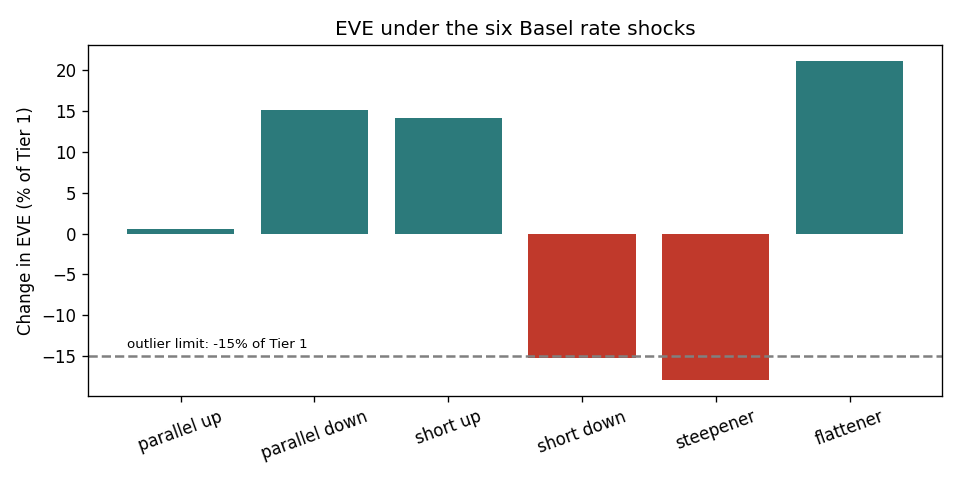

# Bank Balance-Sheet Risk Model: Interest-Rate Risk (IRRBB) and Liquidity (LCR)

A small, tested Python model of a stylised Indian bank's balance sheet (INR 63,500 crore) that measures
**interest-rate risk in the banking book** (economic value of equity and net interest income under the six
Basel standard rate shocks) and **liquidity** (Basel III Liquidity Coverage Ratio under stress), with built-in
model checks and a recommended fix when a limit is breached. The balance sheet and yield curve are
**illustrative**, not any real bank.



## Key results
- **EVE sensitivity (% of Tier 1):** parallel up +0.6%, parallel down +15.2%, short up +14.1%, short down −15.3%,
  **steepener −17.9%**, flattener +21.2%. Most home loans are repo-linked and reprice quarterly, so parallel moves
  matter little; the risk sits in the curve's shape, from long fixed-rate assets (10-year G-secs, fixed home loans).
- **Supervisory outlier test:** the steepener breaches the 15%-of-Tier-1 limit.
- **Fix:** moving INR 1,750 crore from 10-year to 2-year government bonds brings every shock within the limit. A
  single 10-year pay-fixed swap was also tested: it cures the steepener but pushes the short-rates-down scenario
  over the limit, so shortening the bond book is the cleaner fix.
- **NII:** the bank is asset-sensitive: +100bp raises 12-month NII by INR 221 crore, because loans reprice faster
  than deposits.
- **Liquidity:** LCR is 129% under Basel run-off rates (green) but falls to 81% if deposit run-off is 1.5x the Basel
  rates, and 53% in an extreme scenario with falling bond prices: the buffer is adequate but thin against a deposit run.
- **Model checks pass:** balance sheet balances; EVE PV01 is -0.8 crore per bp and linear for small moves.

## How it works
| File | What it does |
| --- | --- |
| `src/balance_sheet.py` | 14 balance-sheet lines with amount, fixed/floating, coupon, maturity or repricing date, and liquidity attributes |
| `src/irrbb.py` | Cash flows, zero-curve discounting, the six Basel shock shapes (INR calibration: 400/500/300bp), EVE and NII |
| `src/lcr.py` | HQLA with Level 2A haircut and 40% cap, run-off and inflow rates with the 75% inflow cap, RAG status |
| `src/validation.py` | Balance check, PV01 linearity check, supervisory outlier test, and a search for the smallest fix |
| `run.py` | Runs everything and writes `results/` and `charts/` |

## Limitations
- Behavioural assumptions (deposit maturities, run-off rates, prepayment) drive the results; a real model would
  estimate them from data and test them separately.
- No optionality (prepayment on home loans, deposit withdrawal behaviour as rates move) and no basis risk.
- One illustrative yield curve; scenarios are the Basel standard set, not bank-specific stress scenarios.

## Run it
```bash
pip install -r requirements.txt
pytest -q          # 7 tests: pricing, shock shapes, LCR caps, balance, PV01, the fix search
python run.py
```
